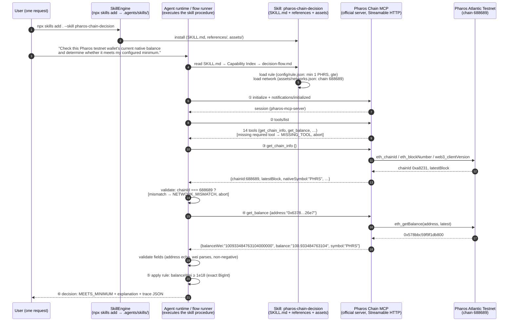

# Flow Diagram — Skill + Chain MCP composition (Task 8)

## What calls what, in what order (one user request)

## Call order table

| # | Call | Direction | Purpose | Failure behavior |
|---|------|-----------|---------|------------------|
| 0 | `npx skills add . --skill pharos-chain-decision -a opencode` | SkillEngine CLI → `.agents/skills/` | registers/installs the Skill | install error reported by CLI |
| 1 | load `config/rule.json` + `assets/networks.json` | runner → skill assets | resolves minimum, comparison, network | `CONFIG_*` errors, no network I/O |
| 2 | MCP `initialize` / `notifications/initialized` | runner → Chain MCP | opens Streamable-HTTP session | `MCP_CONNECTION_FAILED` |
| 3 | MCP `tools/list` | runner → Chain MCP | verifies `get_chain_info` + `get_balance` exist | `MISSING_TOOL` |
| 4 | MCP `get_chain_info` `{}` | runner → Chain MCP → Pharos RPC | pins the network (chain 688689) + block | `NETWORK_MISMATCH` / `INVALID_MCP_OUTPUT` |
| 5 | MCP `get_balance` `{address}` | runner → Chain MCP → Pharos RPC | the live value the decision depends on | `INVALID_ADDRESS` (pre-check), `MCP_TOOL_ERROR`, `INVALID_MCP_OUTPUT` |
| 6 | rule evaluation (in-process) | runner | `balanceWei` vs `minimumWei`, exact BigInt | never runs without live data from step 5 |
| 7 | decision + explanation + trace | runner → user / disk | `demo/traces/trace-<id>.json` | errors still produce a trace |

## Why the decision genuinely depends on the live data

- The only inputs to the comparison are (a) the rule file and (b) `balanceWei` returned
  by `get_balance` in step 5 of the same run. There is no cache, no fallback, no default.
- Unit tests (fixture adapter) prove the machinery; live tests assert the consistency
  property on real endpoints: `decision === MEETS_MINIMUM ⇔ liveBalanceWei ≥ minimumWei`.
- The same wallet produced different balances across runs during development
  (100.934260254104 → 100.933484763104 PHRS), and traces record block numbers — the
  data is demonstrably fetched per run, not stored.

## Profiles (same skill, two official endpoints)

| Profile | Endpoint | Chain | Used by |
|---|---|---|---|
| `atlantic-testnet` (default) | `http://127.0.0.1:3001/mcp` (self-hosted official server) | 688689 | FLOW 1, FLOW 2 in the demo |
| `hosted-mainnet` | `https://mcp.pharos.xyz/mcp` (official hosted) | 1672 | FLOW 3 in the demo |

A rule targeting `atlantic-testnet` combined with the `hosted-mainnet` profile aborts at
step 4 with `NETWORK_MISMATCH` — cross-network data can never leak into a decision.
